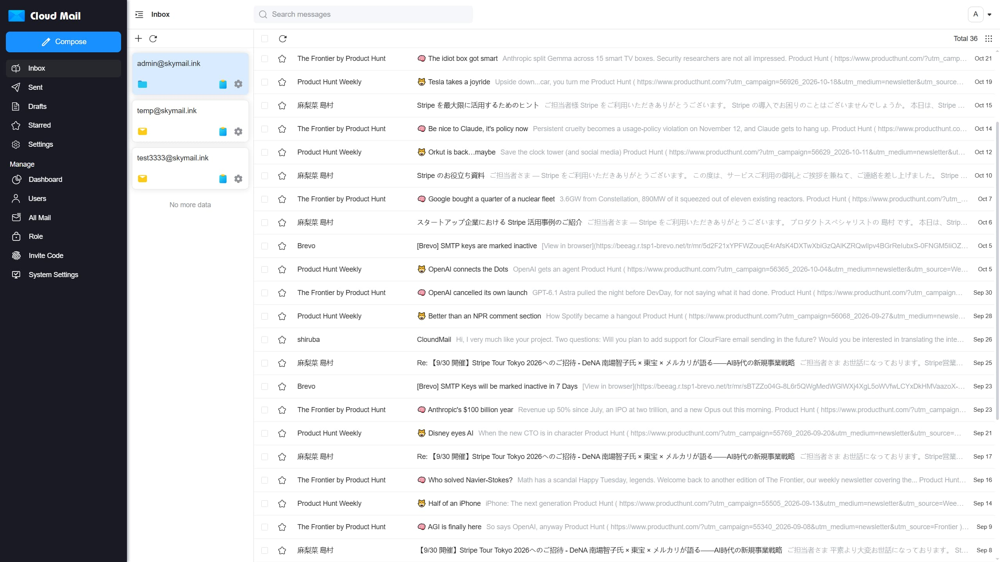
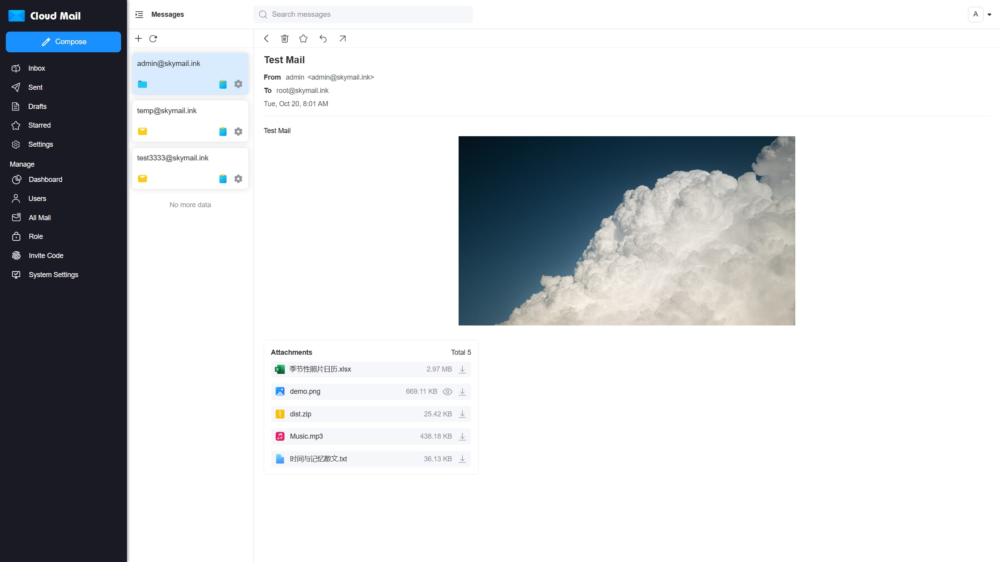
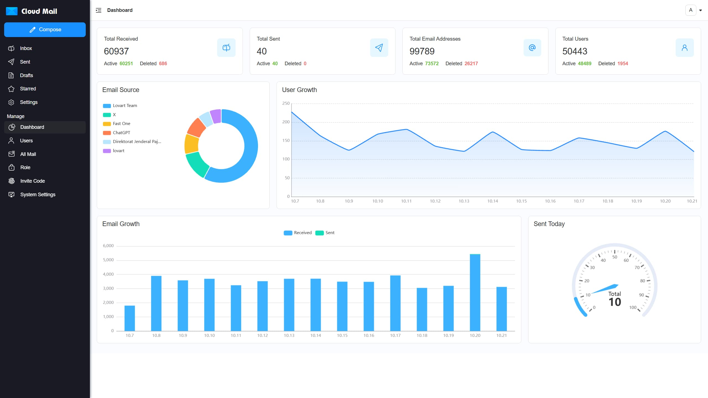
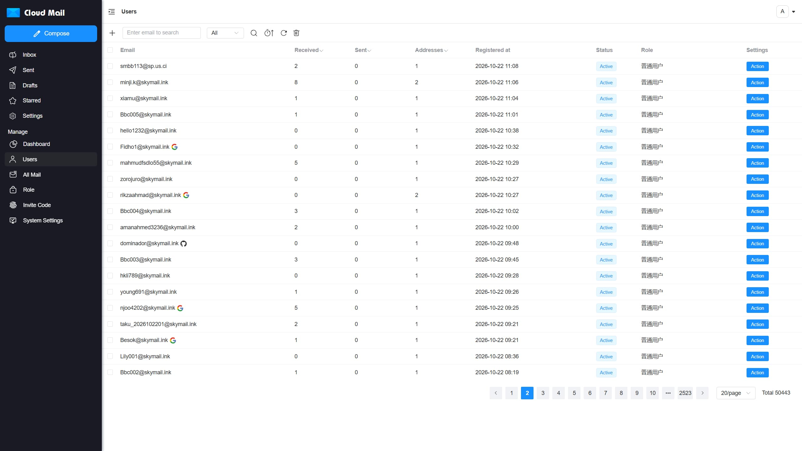

<p align="center">
    
    <h1 align="center">Cloud Mail</h1>
    <p align="center">An all-in-one email service platform powered by Cloudflare</p>
    <p align="center">
        <a href="https://www.cloudflare.com/" target="_blank">
            
        </a>
        <a href="https://github.com/maillab/cloud-mail/releases" target="_blank" >
            
        </a>
        <a href="https://github.com/maillab/cloud-mail/tree/main?tab=MIT-1-ov-file" target="_blank" >
            
        </a>
    </p>
    <p align="center">
        <a href="https://skymail.ink">デモサイト</a> · <a href="https://docs.skymail.ink/en/">デプロイガイド</a> ·
        <a href="/README.md">简体中文</a> | <a href="/README-en.md">English</a> | 日本語
    </p>
    <p align="center">
        <a href="https://trendshift.io/repositories/20459" target="_blank" >
            
        </a>
        <a href="https://hellogithub.com/repository/1b1da1f9ae4c4175baa3d762b4e0ba41" target="_blank">
            
        </a>
    </p>
</p>

## 概要
ドメインが 1 つあれば、大手メールサービスのように複数の異なるメールアドレスを作成できます。このプロジェクトは Cloudflare Workers にデプロイできるため、サーバー費用を抑えながら自分専用のメールサービスを構築できます。
## プロジェクトのスクリーンショット

|   |  |
|-----------------------------|-----------------------------|
|  |  |

## おすすめのプロジェクト

<table>
  <tr>
    <td valign="middle">
      <a href="https://github.com/pixtalelab/pixtale">
        
      </a>
    </td>
    <td valign="middle">
      <a href="https://github.com/pixtalelab/pixtale">Pixtale</a>
    </td>
    <td valign="middle">
      セルフホスト型のクラウドストレージ写真アルバムアプリ
    </td>
  </tr>
</table>

## 機能

- **💰 低コスト**: サーバー不要で、Cloudflare Workers にデプロイしてコストを抑えられます。

- **💻 レスポンシブデザイン**: デスクトップとほとんどのモバイルブラウザに自動で対応します。

- **📧 メール送信**: Cloudflare Email と Resend を統合し、メールを送信できます。

- **🛡️ 管理者機能**: RBAC ベースのアクセス制御により、ユーザーとメールを管理できます。

- **📦 添付ファイル対応**: 添付ファイルを送受信でき、R2 オブジェクトストレージで保存・ダウンロードします。

- **🔔 メールプッシュ**: 受信したメールを Telegram ボットやほかのメールプロバイダーに転送できます。

- **📡 オープン API**: API によるユーザーの一括作成と、複数条件でのメール検索に対応しています

- **🔢 認証コードの認識**: Workers AI で認証コードを自動検出します

- **📈 データの可視化**: ECharts を使い、ユーザーやメールの増加などのシステムデータを可視化します。

- **🎨 パーソナライズ**: サイトのタイトル、ログイン画面の背景、透明度をカスタマイズできます。

- **🤖 CAPTCHA**: Turnstile CAPTCHA を統合し、自動登録を防止します。

- **📜 その他の機能**: 開発中です...

## 技術スタック

- **プラットフォーム**: [Cloudflare Workers](https://developers.cloudflare.com/workers/)

- **Web フレームワーク**: [Hono](https://hono.dev/)

- **ORM**: [Drizzle](https://orm.drizzle.team/)

- **フロントエンドフレームワーク**: [Vue3](https://vuejs.org/)

- **UI フレームワーク**: [Element Plus](https://element-plus.org/)

- **メール送信**: [Cloudflare Email](https://developers.cloudflare.com/email-service/) / [Resend](https://resend.com/)

- **キャッシュ**: [Cloudflare KV](https://developers.cloudflare.com/kv/)

- **データベース**: [Cloudflare D1](https://developers.cloudflare.com/d1/)

- **ファイルストレージ**: [Cloudflare R2](https://developers.cloudflare.com/r2/)

## プロジェクト構成

```
cloud-mail
├── mail-worker                    # Backend worker project
│   ├── src
│   │   ├── api                    # API layer
│   │   ├── const                  # Project constants
│   │   ├── dao                    # Data access layer
│   │   ├── email                  # Email processing and handling
│   │   ├── entity                 # Database entities
│   │   ├── error                  # Custom exceptions
│   │   ├── hono                   # Web framework, middleware, error handling
│   │   ├── i18n                   # Internationalization
│   │   ├── init                   # Database and cache initialization
│   │   ├── model                  # Response data models
│   │   ├── security               # Authentication and authorization
│   │   ├── service                # Business logic layer
│   │   ├── template               # Message templates
│   │   ├── utils                  # Utility functions
│   │   └── index.js               # Entry point
│   ├── package.json               # Project dependencies
│   └── wrangler.toml              # Project configuration
│
├── mail-vue                       # Frontend Vue project
│   ├── src
│   │   ├── axios                  # Axios configuration
│   │   ├── components             # Custom components
│   │   ├── echarts                # ECharts integration
│   │   ├── i18n                   # Internationalization
│   │   ├── init                   # Startup initialization
│   │   ├── layout                 # Main layout components
│   │   ├── perm                   # Permissions and access control
│   │   ├── request                # API request layer
│   │   ├── router                 # Router configuration
│   │   ├── store                  # Global state management
│   │   ├── utils                  # Utility functions
│   │   ├── views                  # Page components
│   │   ├── app.vue                # Root component
│   │   ├── main.js                # Entry JS file
│   │   └── style.css              # Global styles
│   ├── package.json               # Project dependencies
└── └── env.release                # Environment configuration

```

## ライセンス

このプロジェクトは [MIT](LICENSE) ライセンスの下で公開されています。

## コミュニティ

[Telegram](https://t.me/cloud_mail_tg)
